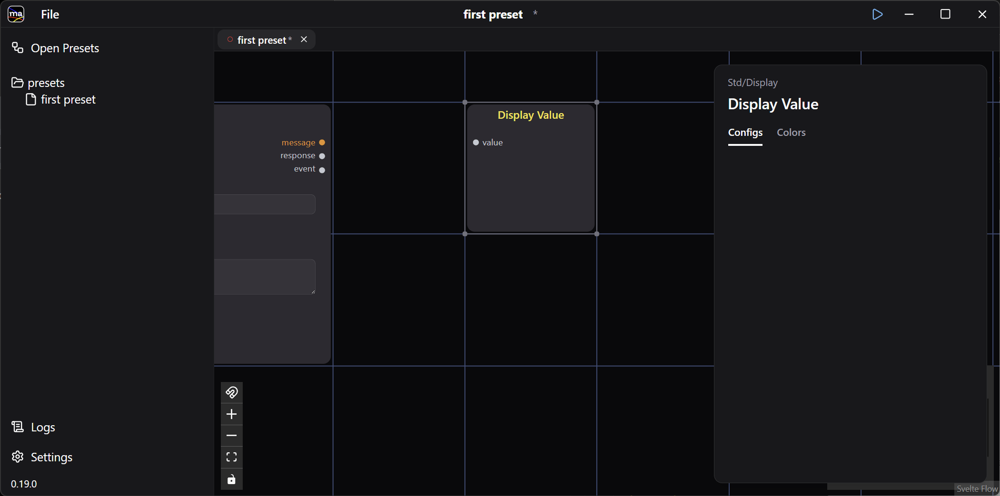

[Your First Preset](../first-preset/) displayed whatever you typed. This walkthrough puts a **Chat** agent between String Input and Display Value, turning the preset into a call to an LLM chat API.

:::note[You need an LLM endpoint]
This preset calls a real model. Have one ready before you start: an OpenAI or Anthropic API key, or a local server such as LM Studio or Ollama. Step 2 shows where each one goes.
:::

## 1. Create a Preset and Add the Agents

Create a new preset the same way as in [the previous guide](../first-preset/), then add two agents: **Std / Input / String Input** and **LLM / Chat**.

## 2. Set the LLM Endpoint

The LLM endpoint and API key live in **Settings**, at the bottom left of the window.

:::tip[Using a local LLM]
Point **OpenAI API Base URL** at any OpenAI-compatible endpoint to run against a local model. The screenshot above uses LM Studio on `http://localhost:1234/v1`.
:::

## 3. Add the Output Agent and Wire Them Up

Back on the preset canvas, add **Std / Display / Display Value**.

Selecting an agent opens its config panel on the right. Simple fields are editable directly on the node too, which is what the next step does.

Connect the agents by dragging between their ports: `string` on String Input to `message` on Chat, then `message` on Chat to `value` on Display Value. Chat also emits `response` (the raw provider payload) and `event` (streaming events) — leave both unconnected.

The `model` field takes a provider-prefixed name — `openai/…`, `claude/…`, or `ollama/…`. The prefix selects which credentials from **Settings** to use, not who hosts the model, so the local LM Studio model below is still written with the `openai/` prefix. Without a prefix the agent fails with _"requires a provider prefix."_ The default is `openai/gpt-5-nano`, which is what the previous screenshot shows.

The layout below is also tidied up.

## 4. Run the Preset

Press the ▶ button in the title bar, or right-click and choose **Play** (`Ctrl+.`).

The preset switches to run mode.

Type into String Input to call the chat API. The reply arrives in Display Value.

## 5. When Nothing Comes Back

A failing agent shows a red alert icon beside its title — hover it for the message. **Logs**, at the bottom left, has the full trace.

- **"requires a provider prefix"** — the `model` field is missing its `openai/`, `claude/`, or `ollama/` prefix
- **Connection refused** — the endpoint in Settings is not running, or the base URL is wrong
- **Model not found** — the name after the prefix does not exist at that endpoint
- **Settings edits appear to do nothing** — restart the running preset, as the Settings screen warns

## 6. Save

Save the preset with **File &gt; Save**.

Now change one thing and run it again — swap in a different Std agent, or put another agent between String Input and Chat.
