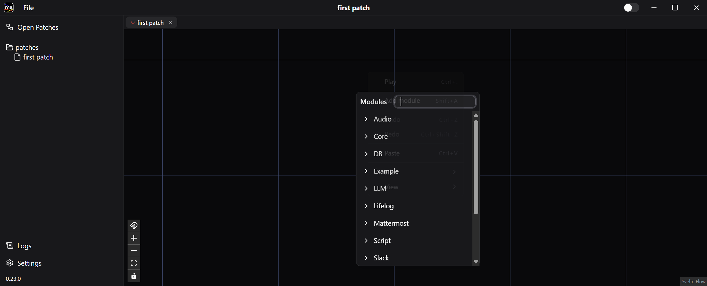
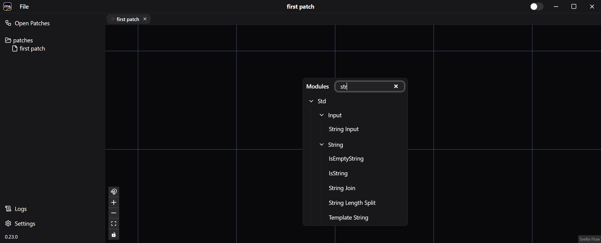
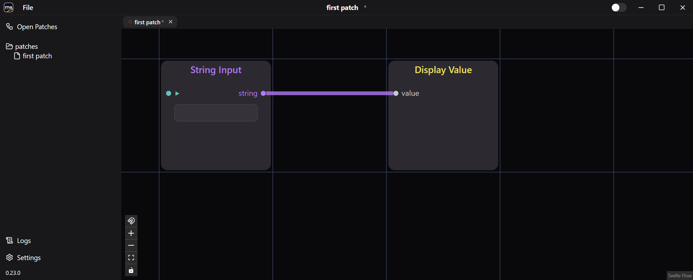

A patch is a saved graph of connected modules — the unit you build, run, and share. This walkthrough builds the smallest one possible: it just displays whatever you type.

## 1. Create a Patch

The first launch opens the Open Patches window.

Click **+ New Patch**, type a name such as `first patch`, and press **New**.

The patch opens on an empty canvas.

## 2. Add the Input and Display Modules

Right-click the blue grid and choose **Add module** — double-clicking the canvas or pressing `Shift+A` does the same thing.

The module list opens, grouped by package.

Type in the search box to narrow it down, then pick **Std / Input / String Input**.

The String Input module appears on the canvas.

Add **Std / Display / Display Value** the same way.

## 3. Wire Them Up

Connect the modules by dragging between their ports: `string` on String Input to `value` on Display Value.

## 4. Run the Patch

Switch on the **Run** toggle in the title bar, or right-click and choose **Play** (`Ctrl+.`).

The patch switches to run mode: the grid disappears, the toggle lights up, and the node fields go live.

Type `Hello, world!` into String Input. The same string appears in Display Value.

## 5. Save

Save the patch with **File &gt; Save**. To stop it, switch the **Run** toggle off or choose **Stop** (`Ctrl+.`) from the right-click menu.

Next, [Using the Chat Module](../chat-patch/) puts an LLM between these two modules and turns the patch into a conversation with a model.
