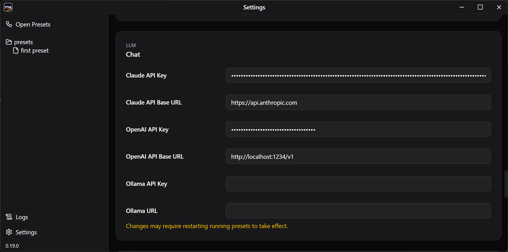
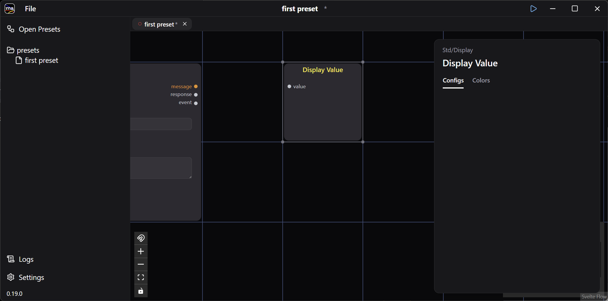
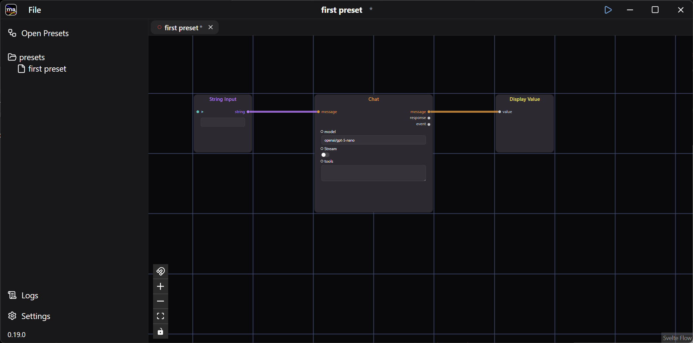
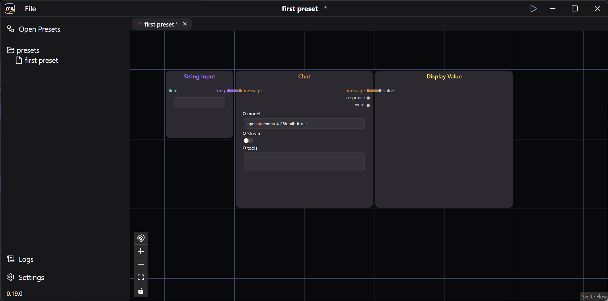
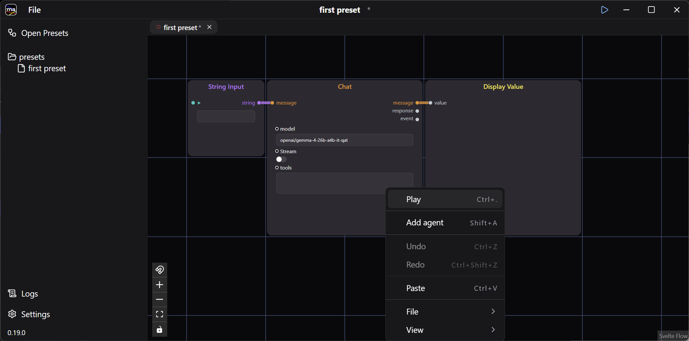
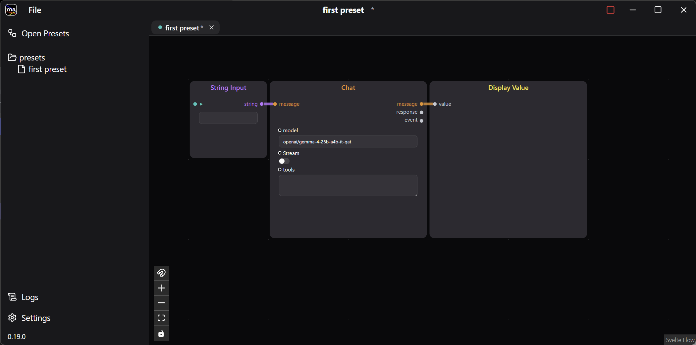

This walkthrough builds a small preset that calls an LLM chat API.

## 1. Create a Preset

The first launch opens the Open Presets window.

Click **+ New Preset**, type a name such as `first preset`, and press **New**.

The preset opens on an empty canvas.

## 2. Add the Input and Chat Agents

Right-click the blue grid and choose **Add agent** — double-clicking the canvas or pressing `Shift+A` does the same thing.

The agent list opens, grouped by package.

Type in the search box to narrow it down, then pick **Std / Input / String Input**.

The String Input agent appears on the canvas.

Add **LLM / Chat** the same way.

## 3. Set the LLM Endpoint

The LLM endpoint and API key live in **Settings**, at the bottom left of the window.

:::tip[Using a local LLM]
Point **OpenAI API Base URL** at any OpenAI-compatible endpoint to run against a local model. The screenshot above uses LM Studio on `http://localhost:1234/v1`.
:::

## 4. Add the Output Agent and Wire Them Up

Back on the preset canvas, add **Std / Display Value**.

Connect the three agents by dragging between their ports.

Set the `model` field if your endpoint needs it. The layout below is also tidied up.

## 5. Run the Preset

Press the ▶ button in the title bar, or right-click and choose **Play** (`Ctrl+.`).

The preset switches to run mode.

Type into String Input to call the chat API. The reply arrives in Display Value.

## 6. Save

Save the preset with **File > Save**.
