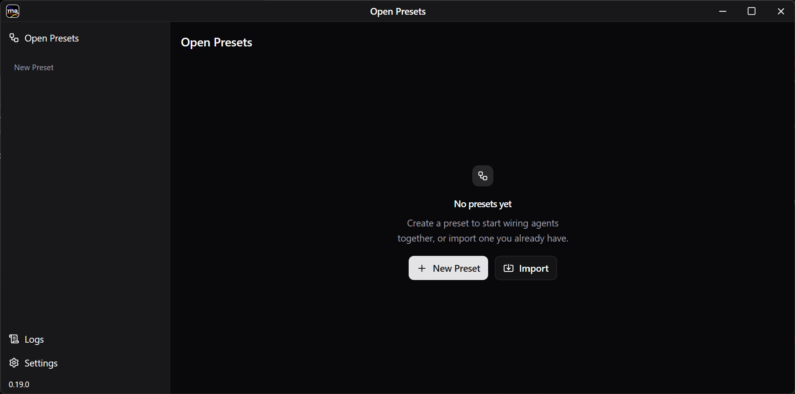
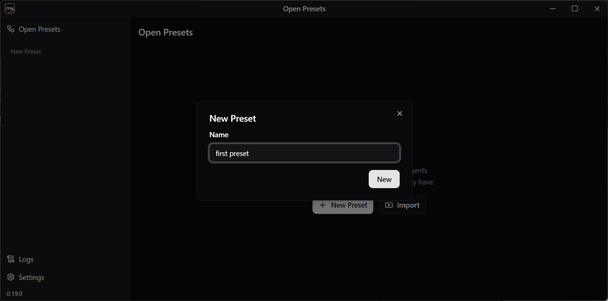
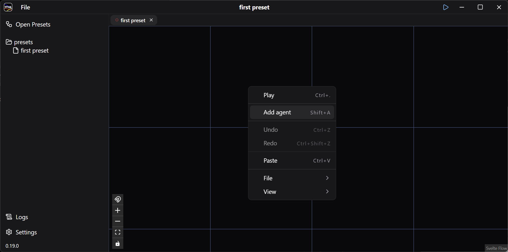
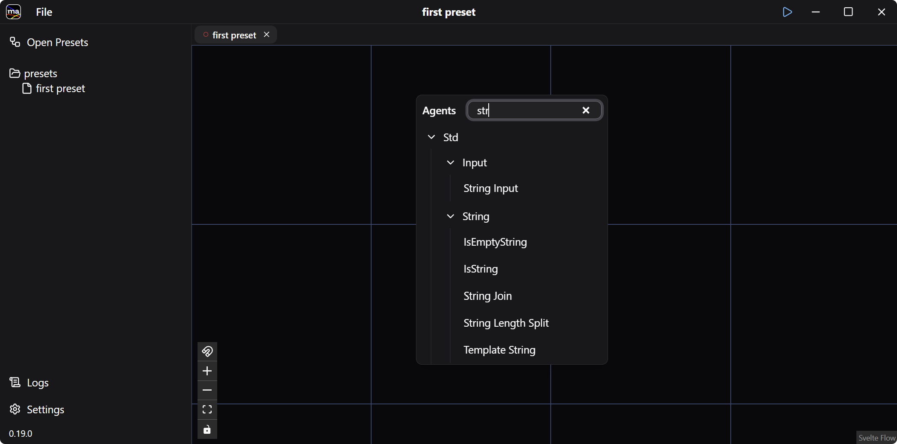
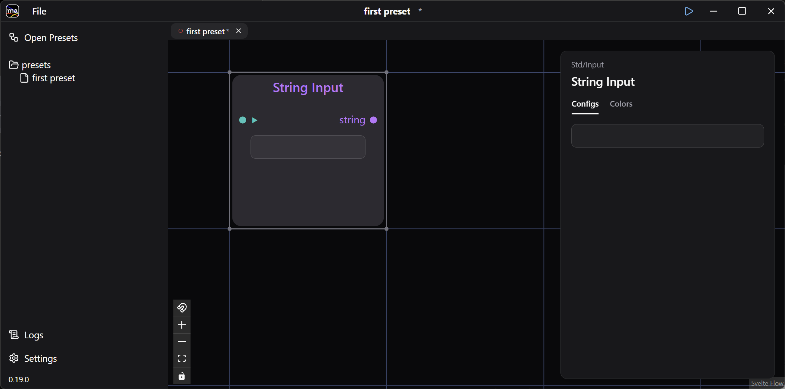
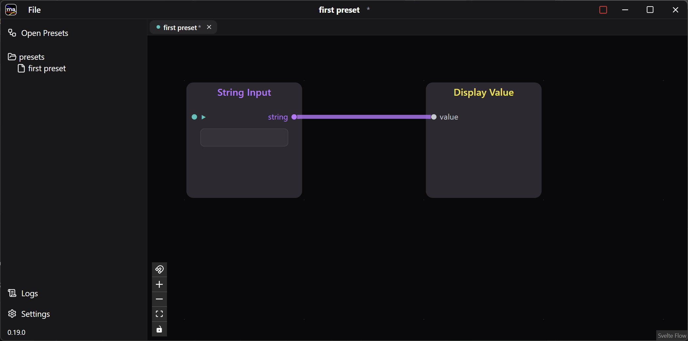
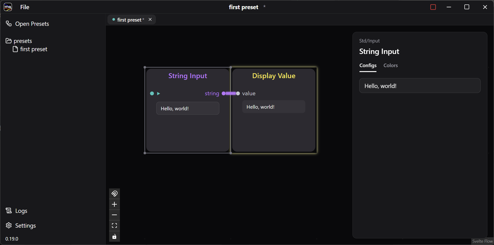

A preset is a saved graph of connected agents — the unit you build, run, and share. This walkthrough builds the smallest one possible: it just displays whatever you type.

## 1. Create a Preset

The first launch opens the Open Presets window.

Click **+ New Preset**, type a name such as `first preset`, and press **New**.

The preset opens on an empty canvas.

## 2. Add the Input and Display Agents

Right-click the blue grid and choose **Add agent** — double-clicking the canvas or pressing `Shift+A` does the same thing.

The agent list opens, grouped by package.

Type in the search box to narrow it down, then pick **Std / Input / String Input**.

The String Input agent appears on the canvas.

Add **Std / Display / Display Value** the same way.

## 3. Wire Them Up

Connect the agents by dragging between their ports: `string` on String Input to `value` on Display Value.

## 4. Run the Preset

Press the ▶ button in the title bar, or right-click and choose **Play** (`Ctrl+.`).

The preset switches to run mode: the grid disappears, ▶ becomes a red ■, and the node fields go live.

Type `Hello, world!` into String Input. The same string appears in Display Value.

## 5. Save

Save the preset with **File &gt; Save**. To stop it, press the red ■ in the title bar or choose **Stop** (`Ctrl+.`) from the right-click menu.

Next, [Using the Chat Agent](../chat-preset/) puts an LLM between these two agents and turns the preset into a conversation with a model.
