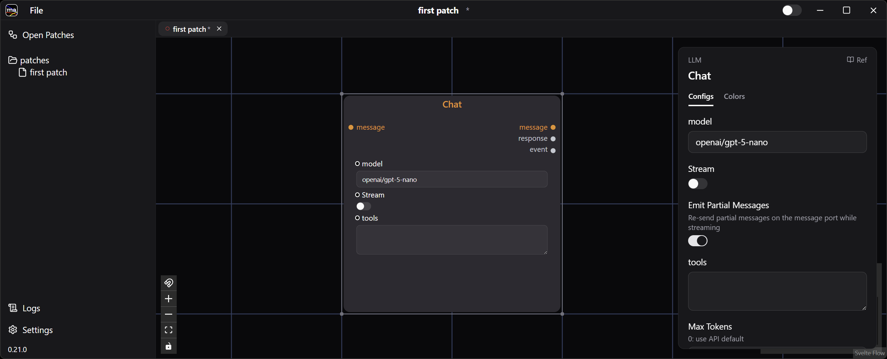
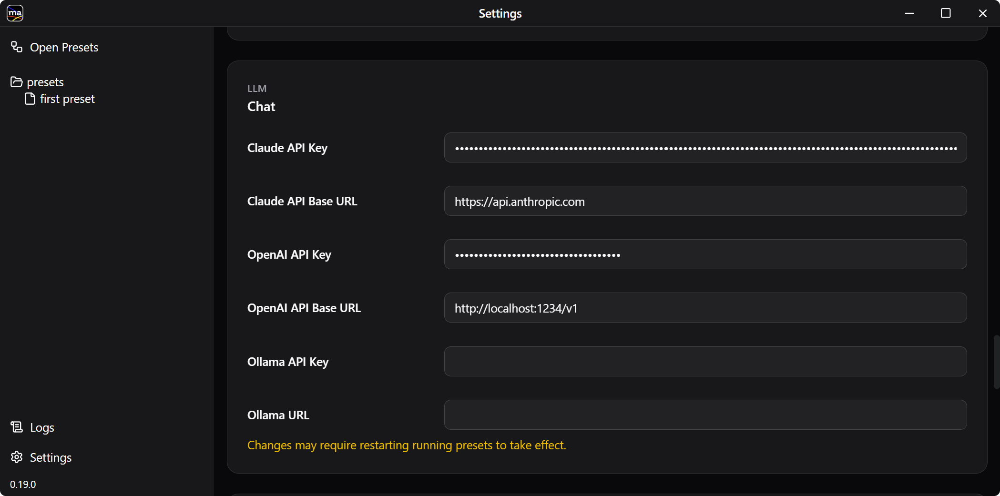
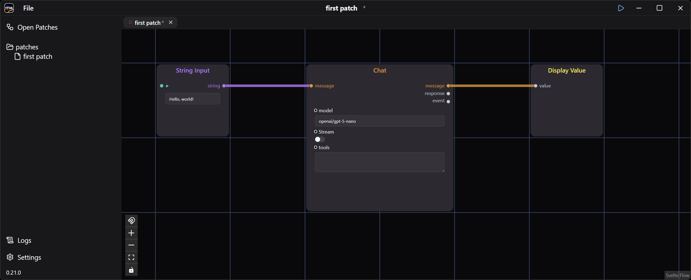
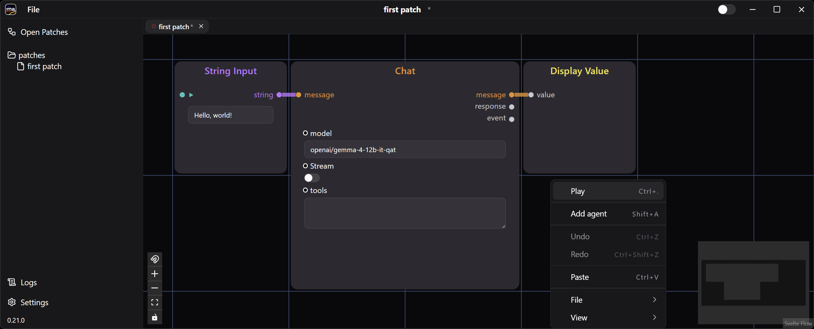
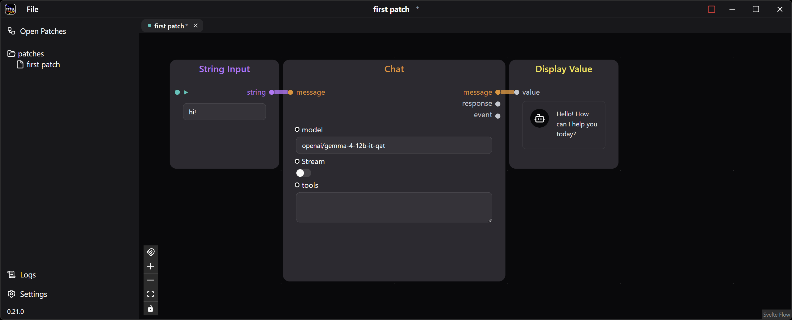

[はじめてのパッチ](../first-patch/)では、入力した文字列をそのまま表示しました。ここではその続きとして、String Input と Display Value の間に **Chat** エージェントを挟み、LLM の Chat API を呼び出すパッチに作り変えます。

:::note[LLM のエンドポイントが必要です]
このパッチは実際にモデルを呼び出します。OpenAI か Anthropic の API キー、または LM Studio や Ollama などのローカルサーバーを事前に用意してください。設定場所は手順 2 で説明します。
:::

## 1. Chat エージェントを追加する

[前のガイド](../first-patch/)で保存した `first patch` をそのまま使います。閉じてしまった場合は Open Patches ウィンドウから開き直してください。ここに **LLM / Chat** エージェントを 1 つ追加します。

## 2. LLM のエンドポイントを設定する

LLM のエンドポイントと API キーの設定は、ウィンドウ左下の **Settings** から行います。

:::tip[ローカル LLM を使う]
**OpenAI API Base URL** に OpenAI 互換のエンドポイントを指定すると、ローカルの LLM を使えます。上のスクリーンショットでは LM Studio のエンドポイント `http://localhost:1234/v1` を指定しています。
:::

## 3. 配線を変更する

パッチ画面に戻ります。前のガイドで繋いだワイヤーは String Input から Display Value へ直接伸びたままなので、クリックして選択し `Delete` キーで削除します。

次に、ポート間をドラッグして Chat を経由するように繋ぎ直します。String Input の `string` を Chat の `message` へ、Chat の `message` を Display Value の `value` へ繋いでください。Chat は `response`（プロバイダの生のレスポンス）と `event`（ストリーミングイベント）も出力しますが、どちらも繋がなくて構いません。

エージェントを選択すると、右側に設定パネルが開きます。単純な項目はノード上で直接編集することもでき、次の手順ではそちらを使います。

`model` にはプロバイダ接頭辞付きのモデル名（`openai/…`、`claude/…`、`ollama/…`）を指定します。接頭辞が選ぶのは **Settings** のどの認証情報を使うかであって、モデルの提供元ではありません。そのため下の図のローカルの LM Studio のモデルも `openai/` 接頭辞で書きます。接頭辞がないと _"requires a provider prefix"_ エラーになります。デフォルトは `openai/gpt-5-nano` で、前の図に表示されているのがそれです。

下の図ではレイアウトも調整しています。

## 4. パッチを実行する

ウィンドウタイトル上の ▶ ボタンを押すか、右クリックから **Play**（`Ctrl+.`）を選択します。

パッチが実行モードになります。

String Input に入力すると LLM の Chat API が呼び出され、返答が Display Value に表示されます。

## 5. 応答が返ってこないとき

失敗したエージェントはタイトルの横に赤いアラートアイコンを表示します。ホバーするとメッセージを読めます。左下の **Logs** には詳細なログがあります。

- **"requires a provider prefix"** — `model` に `openai/`、`claude/`、`ollama/` のいずれの接頭辞も付いていない
- **接続エラー** — Settings で指定したエンドポイントが起動していないか、ベース URL が誤っている
- **モデルが見つからない** — 接頭辞の後ろの名前が、そのエンドポイントに存在しない
- **Settings を変更しても反映されない** — Settings 画面の警告のとおり、実行中のパッチを再起動する

## 6. 保存する

**File > Save** でパッチを保存しておきましょう。

ここから一箇所だけ変えて実行してみてください。Display Value を別の Std エージェントに差し替える、String Input と Chat の間に別のエージェントを挟む、など。
