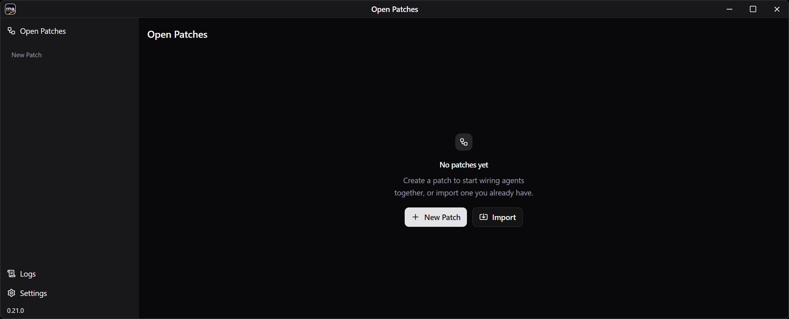
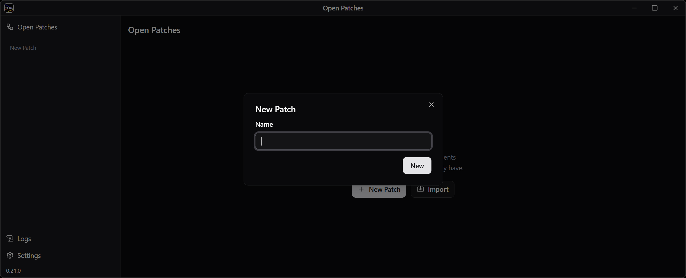
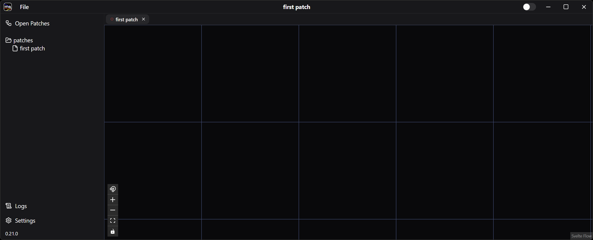
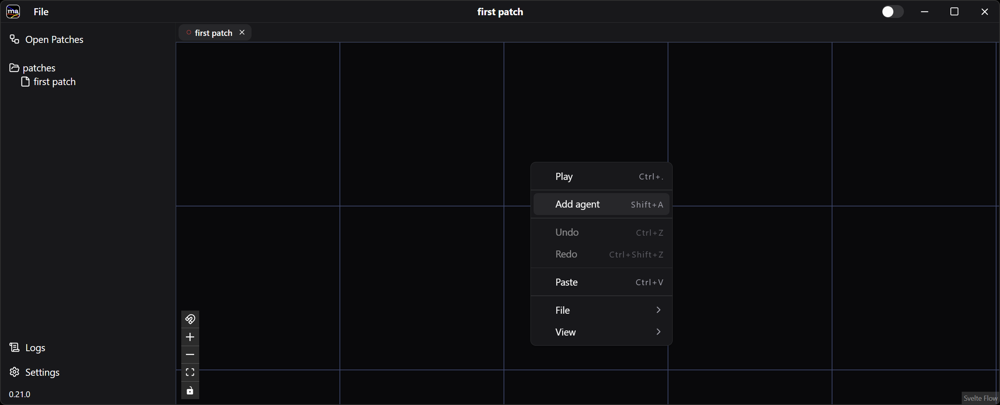
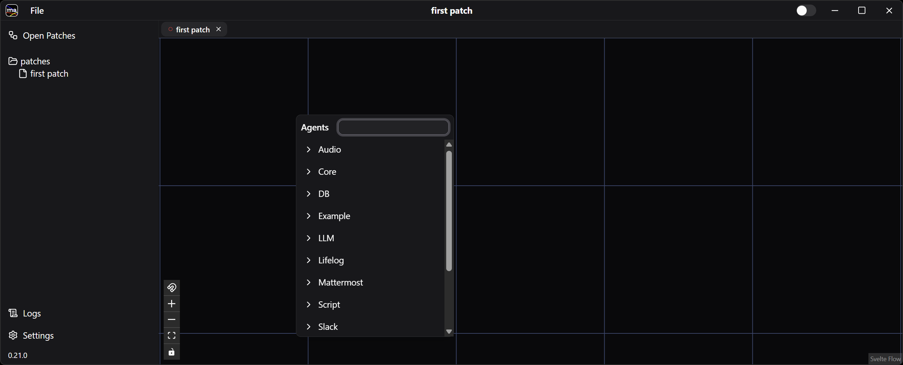
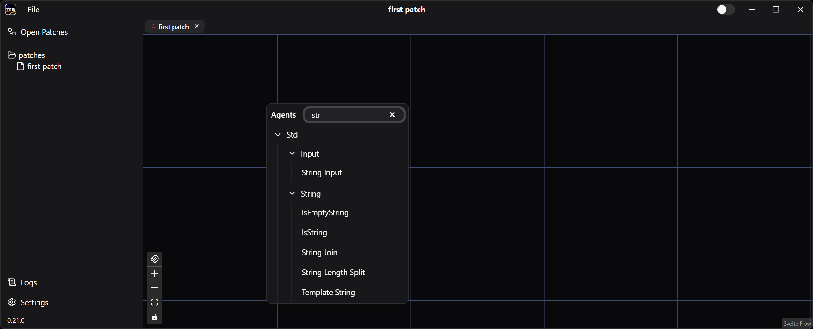
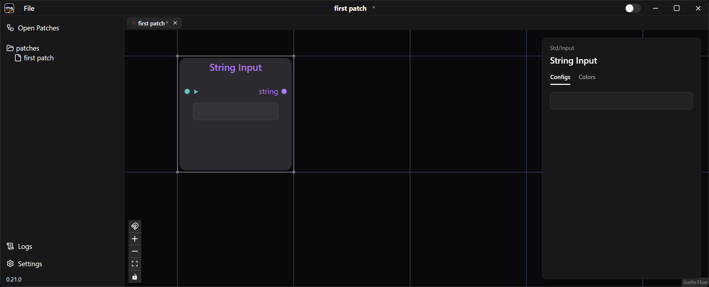
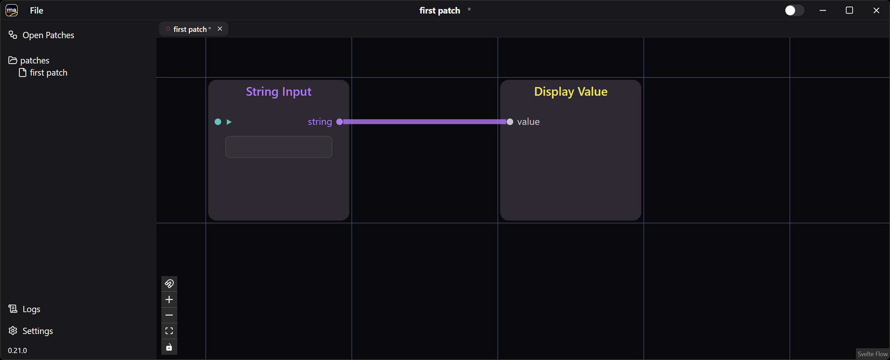
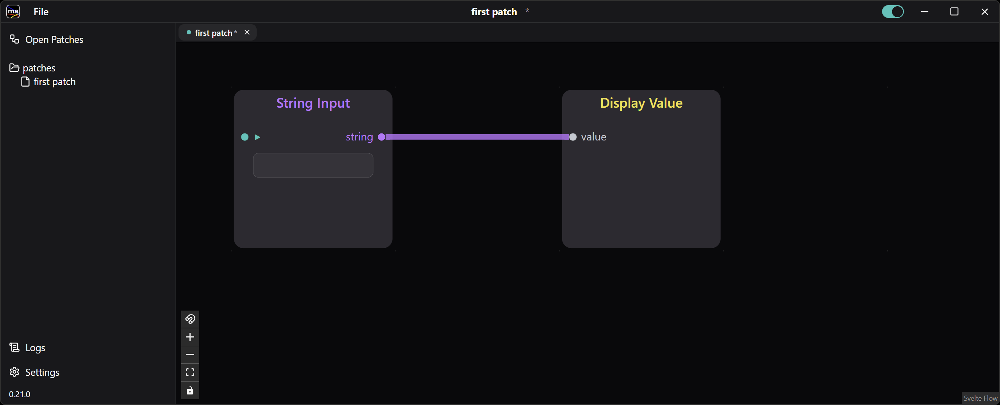
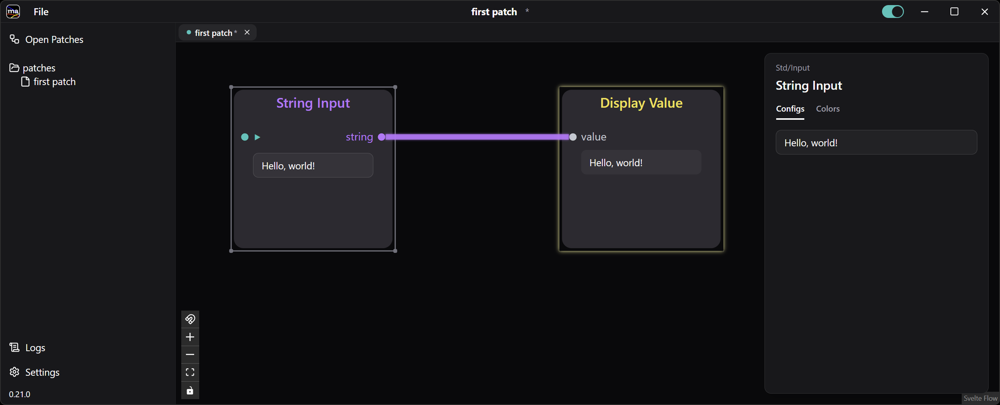

Modular Agentではエージェントをワイヤーで繋いだものをパッチといいます。
ここでは、入力した文字列をそのまま表示するだけの、単純なパッチを作成します。

## 1. パッチを作成する

デスクトップアプリを初めて立ち上げると、Open Patches ウィンドウが開きます。

**+ New Patch** ボタンをクリックし、`first patch` など好きな名前を入力して **New** を押します。

新しいパッチの画面が開きます。

## 2. 入力エージェントと表示エージェントを追加する

青い格子が表示されているエリアで右クリックし **Add agent** を選びます。ダブルクリック、または `Shift+A` でも同じです。

エージェントのリストがパッケージごとに分類されて表示されます。

検索ボックスで絞り込み、**Std / Input / String Input** を選びます。

String Input エージェントが表示されます。

同様に **Std / Display / Display Value** エージェントを追加します。

## 3. エージェントを繋ぐ

ポート間をドラッグして、エージェントを繋ぎます。String Input の `string` を Display Value の `value` へ繋いでください。

## 4. パッチを実行する

タイトルバーの **Run** トグルをオンにするか、右クリックから **Play**（`Ctrl+.`）を選択します。

パッチが実行モードになります。格子が消え、トグルが点灯し、ノードの各項目が動作するようになります。

String Input に `Hello, world!` と入力してみましょう。入力した文字列がそのまま Display Value に表示されます。

## 5. 保存する

**File > Save** でパッチを保存しておきましょう。停止するには、タイトルバーの **Run** トグルをオフにするか、右クリックメニューから **Stop**（`Ctrl+.`）を選びます。

次の [Chat エージェントを使う](../chat-patch/) では、2 つのエージェントの間に LLM を挟んで、モデルと会話できるパッチを作ります。
