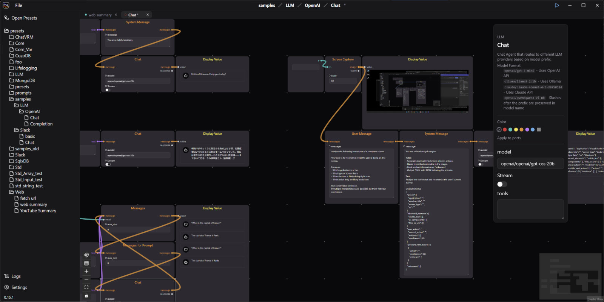

**Modular Agent** は、モジュラーシンセのように AI ワークフローを組み立てるためのフレームワークです。
それぞれはシンプルな処理しか行わないエージェント同士をパッチして、LLM、データベース、メッセージングなどをまたぐリアルタイムのパイプラインを構築できます。

## 特長

### エージェント

> 心の一部分とか、心の中の一プロセスであって、それ自体だけで理解できるような、十分単純なもの。
> ただし、エージェントたちの集まり同士のインタラクションによって、もっとずっと理解しにくいような現象が生み出される可能性がある。
> 『心の社会』マーヴィン・ミンスキー

- **様々なエージェント** — LLM、Web/HTTP、Slack、SQL データベース、画面キャプチャなど
- **拡張可能** — Rustクレートとしてエージェントプラグインを追加できる
- **並列動作** — 各エージェントは独立に並列に動作する
- **ストリームベースのデータフロー** — エージェント間をリアルタイムにデータが流れる

### ランタイム

- **ローカル実行** — ローカルで動くアプリケーションとして実行でき、クラウドに依存しない。
- **クロスプラットフォーム** — Windows、macOS、Linux
- **組み込み可能** — コアランタイムは依存が少なく、CLIツール、デスクトップアプリ、サーバー、モバイルデバイスなどRustアプリケーションに組み込めます
